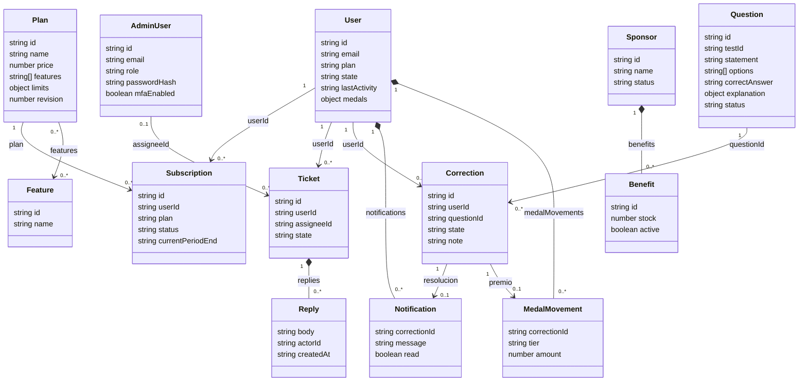

# Diagrama de clases del dominio

Este diagrama UML describe entidades y relaciones del dominio almacenado en Firestore. La implementación usa módulos, funciones y objetos JavaScript; los nombres del diagrama no representan clases JavaScript declaradas. Los atributos muestran los nombres de los campos principales del almacenamiento. La notación de clase permite explicar el modelo sin cambiar su implementación documental.

La composición indica beneficios embebidos o subcolecciones dentro de un documento padre. Las demás asociaciones se resuelven mediante identificadores. Una notificación se crea al resolver; el movimiento de premio solo se crea cuando se confirma la recorrección. Los documentos legados pueden contener referencias ausentes, que el backend debe tratar según el caso.

Se omiten las colecciones auxiliares de métricas, auditoría e idempotencia para mantener legibles las relaciones de negocio. El [modelo de datos](19_MODELO_DATOS_FIRESTORE.md) las detalla, incluye las fuentes revisadas y explica los tipos. `explanation` también admite texto heredado, además del objeto estructurado representado.
